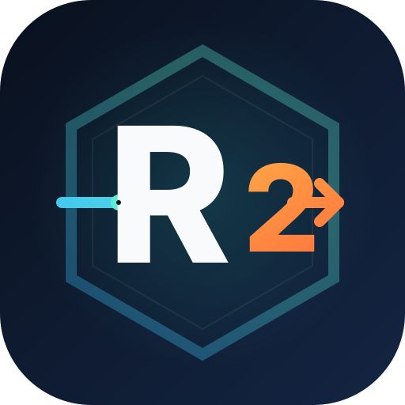

<p align="center">
  
</p>

<h1 align="center">RustO2</h1>

<p align="center">
  <strong>Reimplementazione in Rust del core di WSO2: gateway, OAuth2, JWT, rate limiting e resilienza.</strong>
</p>

RustO2 è un esperimento ingegneristico indipendente che riprende i concetti
chiave di WSO2 (pipeline di mediazione, policy per API, throttling, circuit
breaker, osservabilità) e li ricostruisce su un runtime Rust moderno, senza
application server, OSGi o management console. Non contiene codice WSO2.

> La documentazione completa, i benchmark e la guida curl sono in
> **[README.md](README.md)** (inglese).

## Cosa c'è dentro

| Componente | Ruolo |
|---|---|
| `rusto2-gw` | Proxy HTTP streaming su axum + reqwest, con policy per rotta |
| `rusto2-is` | OAuth2 `client_credentials`, JWT Ed25519, JWKS e discovery |
| `rusto2-common` | Log JSON, correlation ID, metriche e helper condivisi |

Funzionalità principali:

- rotte dichiarative in `rusto2.yaml` con metodi consentiti, scope richiesti,
  quota e circuit breaker;
- propagazione di `X-Forwarded-For`, `X-Forwarded-Proto`, `X-RustO2-Request-Id`
  e `X-Request-Id`;
- validazione JWT locale tramite JWKS in cache, con refresh per rotazione chiavi;
- token bucket su `DashMap` per `client_id` o IP, con `429` e header
  `X-RateLimit-*` / `Retry-After`;
- circuit breaker per rotta con stato `closed` / `open` / `half_open`;
- log strutturati JSON, metriche Prometheus e dashboard Grafana;
- immagini Docker multi-stage distroless e stack demo con httpbin.

## Avvio rapido

```bash
git clone https://github.com/togioia/RustO2.git
cd RustO2
docker compose up -d --build
./scripts/demo.sh
```

Servizi esposti:

| Servizio | URL |
|---|---|
| Gateway | http://localhost:8080 |
| Identity Server | http://localhost:9000 |
| Prometheus | http://localhost:9090 |
| Grafana (`admin` / `admin`) | http://localhost:3000 |
| httpbin diretto | http://localhost:8081 |

## Esempio curl

```bash
TOKEN=$(curl -s -X POST http://localhost:9000/oauth2/token \
  -d "grant_type=client_credentials" \
  -d "client_id=demo-client" \
  -d "client_secret=demo-secret" \
  -d "scope=read write" | sed -n 's/.*"access_token":"\([^"]*\)".*/\1/p')

curl -i -H "Authorization: Bearer $TOKEN" \
  http://localhost:8080/api/get

curl -i http://localhost:8080/public/get     # rotta anonima
curl -i http://localhost:8080/api/get        # 401, token mancante
```

## Test

```bash
cargo test --workspace --all-targets
cargo clippy --workspace --all-targets -- -D warnings
./scripts/smoke.sh
```

## Nota sul progetto

RustO2 è un proof of concept e un portfolio project, non un prodotto pronto per
la produzione. Le credenziali demo sono pubbliche e vanno sostituite. Vedi
[SECURITY.md](SECURITY.md).

Licenza: [Apache-2.0](LICENSE). WSO2 è un marchio di WSO2 LLC; RustO2 non è
affiliato a WSO2.
