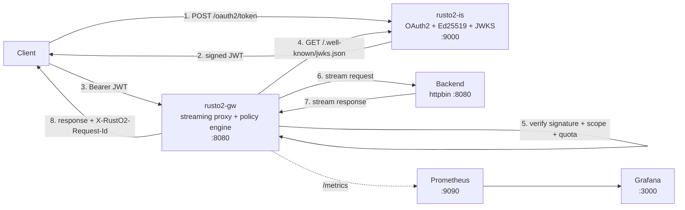
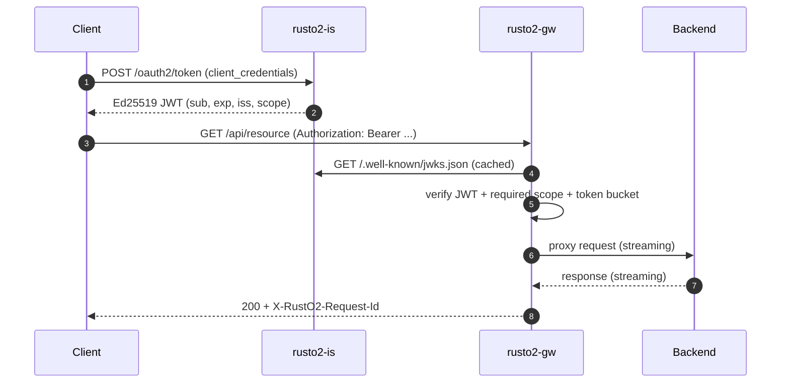

<p align="center">
  
</p>

<h1 align="center">RustO2</h1>

<p align="center">
  <strong>A high-performance Rust re-implementation of the WSO2 gateway core.</strong><br/>
  OAuth2 · Ed25519 JWT · JWKS · rate limiting · circuit breaking · Prometheus · Grafana
</p>

<p align="center">
  <a href="https://github.com/togioia/RustO2/actions/workflows/ci.yml"></a>
  <a href="LICENSE"></a>
  
  
</p>

<p align="center"><a href="README.it.md">Italiano</a></p>

---

## Why RustO2?

WSO2's integration stack is built around a powerful set of ideas: a mediation
pipeline, per-API security policies, throttling, endpoint resilience and
observability. RustO2 rebuilds the *core* of that model in Rust as a focused,
cloud-native experiment:

- **No application server, no OSGi, no management console.** Two static binaries,
  YAML configuration and a container.
- **No garbage collector.** Request handling is ownership-based, so there are no
  GC pauses to pollute tail latency.
- **Streaming by default.** Request and response bodies are piped through the
  gateway without being buffered.
- **Security without shared secrets.** `rusto2-is` signs Ed25519 JWTs and
  publishes the public key as JWKS; `rusto2-gw` verifies tokens locally.

This is **not** a WSO2 fork and contains no WSO2 code. It is an independent
educational/engineering project that maps familiar WSO2 concepts onto a modern
Rust stack.

## What is implemented

| WSO2 concept | RustO2 implementation |
|---|---|
| API Gateway / Synapse mediation | `rusto2-gw`: axum server + streaming reqwest proxy |
| Per-API security policy | Declarative routes in `rusto2.yaml` with method allowlists, JWT and scopes |
| Key manager / OAuth2 token service | `rusto2-is`: `client_credentials`, Ed25519 JWTs, JWKS, discovery |
| JWT validation at the gateway | Axum middleware with in-memory JWKS cache and key rotation refresh |
| Throttling | Sharded `DashMap` token bucket per `client_id` or client IP |
| Endpoint circuit breaker | Per-route closed / open / half-open state machine |
| Observability | JSON logs, request correlation, Prometheus metrics, Grafana dashboard |
| Deployment | Multi-stage distroless images, Docker Compose one-click demo |

### Feature checklist

- [x] Per-route allowlisted methods, upstream and strip-prefix policies
- [x] Streaming request/response proxying with connection pooling
- [x] `X-Forwarded-For`, `X-Forwarded-Host`, `X-Forwarded-Proto`
- [x] `X-RustO2-Request-Id` + `X-Request-Id` correlation end to end
- [x] OAuth2 `POST /oauth2/token` (form or JSON, Basic or body credentials)
- [x] Ed25519 key generation or PEM loading, `kid` thumbprint, JWKS ETag
- [x] JWT signature, `iss`, `aud`, `exp`, `nbf` and scope validation
- [x] Token-bucket rate limiting with `429`, `X-RateLimit-*`, `Retry-After`
- [x] Circuit breaker with `503` fail-fast and half-open recovery
- [x] Prometheus counters, histograms and in-flight gauge on `/metrics`
- [x] Structured JSON logs with request id, route, status and latency
- [x] Docker Compose stack with httpbin, Prometheus and Grafana
- [x] Unit tests, end-to-end smoke script, CI and reproducible benchmarks

## Architecture





### Security model

1. On startup the gateway fetches the JWKS from `rusto2-is` (and keeps retrying if
   the identity server is still booting).
2. Every protected request is checked against a `kid`-selected Ed25519 key.
   Signature, issuer, audience, expiry and not-before are validated.
3. The route's required scopes must be a subset of the token's `scope` claim.
4. An unknown `kid` triggers a rate-limited JWKS refresh, so key rotation works
   without a gateway restart.
5. Failed refreshes keep the last known-good keys: a short identity-server
   outage does not take the data plane down.

### Traffic and resilience

- **Token bucket.** Each `(route, client_id)` or `(route, IP)` key has a bucket
  with `rps` refill and `burst` capacity. DashMap shards the state so unrelated
  clients do not contend on the same lock. Idle buckets are garbage-collected.
- **429 responses** include `X-RateLimit-Limit`, `X-RateLimit-Remaining` and
  `Retry-After`; the request never reaches the backend.
- **Circuit breaker.** Five consecutive upstream errors (configurable) open the
  route circuit. Requests fail fast with `503` and `Retry-After`. After the
  recovery window, a single half-open probe decides whether to close or reopen.

## Quick start

Requirements: Docker with Compose v2. Nothing else.

```bash
git clone https://github.com/togioia/RustO2.git
cd RustO2
docker compose up -d --build
./scripts/demo.sh
```

Then open:

| Service | URL | Credentials |
|---|---|---|
| Gateway | http://localhost:8080 | JWT from `rusto2-is` |
| Identity server | http://localhost:9000 | demo client below |
| Prometheus | http://localhost:9090 | — |
| Grafana | http://localhost:3000 | `admin` / `admin` |
| httpbin (direct) | http://localhost:8081 | — |

Demo clients (override with environment variables):

| client_id | client_secret | scopes |
|---|---|---|
| `demo-client` | `demo-secret` | `read`, `write`, `admin` |
| `readonly-client` | `readonly-secret` | `read` |

> The demo secrets are intentionally public. Replace them via
> `RUSTO2_DEMO_SECRET` / `RUSTO2_READONLY_SECRET` before exposing anything.

## curl cookbook

### 1. Get an access token

```bash
TOKEN=$(curl -s -X POST http://localhost:9000/oauth2/token \
  -H "Content-Type: application/x-www-form-urlencoded" \
  -d "grant_type=client_credentials" \
  -d "client_id=demo-client" \
  -d "client_secret=demo-secret" \
  -d "scope=read write" | sed -n 's/.*"access_token":"\([^"]*\)".*/\1/p')

echo "${TOKEN:0:40}..."
```

HTTP Basic is supported too:

```bash
curl -u demo-client:demo-secret \
  -d "grant_type=client_credentials&scope=read" \
  http://localhost:9000/oauth2/token
```

### 2. Call a protected API

```bash
curl -i -H "Authorization: Bearer $TOKEN" \
  "http://localhost:8080/api/get?hello=rusto2"
```

The gateway forwards the request to httpbin with the original body streamed and
adds the correlation and forwarding headers:

```http
HTTP/1.1 200 OK
x-rusto2-request-id: 0192f0a1-7c3e-7b1a-9a2e-5f2b1c3d4e5f
```

### 3. Exercise security policies

```bash
# 401: no token
curl -i http://localhost:8080/api/get

# 403: read-only client on a write-scoped route
READONLY_TOKEN=$(curl -s -X POST http://localhost:9000/oauth2/token \
  -d "grant_type=client_credentials" \
  -d "client_id=readonly-client" \
  -d "client_secret=readonly-secret" \
  | sed -n 's/.*"access_token":"\([^"]*\)".*/\1/p')
curl -i -H "Authorization: Bearer $READONLY_TOKEN" \
  http://localhost:8080/admin/get

# 405: POST is not allowed on /public
curl -i -X POST http://localhost:8080/public/get

# 200: anonymous route
curl -i http://localhost:8080/public/get
```

### 4. See the rate limiter

```bash
for i in $(seq 1 15); do
  curl -s -o /dev/null -w "%{http_code}\n" http://localhost:8080/public/get
done
```

With `rps: 10` and `burst: 10`, the first requests succeed and the rest return:

```http
HTTP/1.1 429 Too Many Requests
x-ratelimit-limit: 10
x-ratelimit-remaining: 0
retry-after: 1
```

### 5. Inspect JWKS and metrics

```bash
curl -s http://localhost:9000/.well-known/jwks.json | python -m json.tool
curl -s http://localhost:9000/.well-known/openid-configuration | python -m json.tool
curl -s http://localhost:8080/metrics | grep '^rusto2_'
```

Decoded JWT payload:

```json
{
  "sub": "demo-client",
  "iss": "http://localhost:9000",
  "aud": "rusto2",
  "exp": 1790000000,
  "iat": 1789996400,
  "nbf": 1789996400,
  "jti": "0192f0a1-7c3e-7b1a-9a2e-5f2b1c3d4e5f",
  "scope": "read write",
  "client_id": "demo-client"
}
```

## Configuration

### `rusto2.yaml` — gateway

```yaml
server:
  listen: 0.0.0.0:8080
  trust_proxy: false          # honour X-Forwarded-For for the client IP
  request_timeout_secs: 30
  connect_timeout_secs: 5
  pool_max_idle_per_host: 256

identity:
  issuer: http://localhost:9000
  audience: rusto2
  jwks_url: http://localhost:9000/.well-known/jwks.json
  refresh_secs: 300
  leeway_secs: 15

routes:
  - name: httpbin
    prefix: /api
    upstream: http://httpbin:8080
    strip_prefix: true
    methods: [GET, POST, PUT, PATCH, DELETE, HEAD, OPTIONS]
    auth:
      mode: jwt                 # jwt | none
      scopes: [read]
    rate_limit:
      rps: 100
      burst: 200
      key: client               # client | ip
    circuit_breaker:
      failure_threshold: 5
      recovery_secs: 10
```

Routes are matched by longest prefix on segment boundaries, so `/api/v2` can
override `/api`. The method allowlist is enforced **before** authentication and
returns `405` with an `Allow` header.

### `rusto2-is.yaml` — identity server

```yaml
token:
  issuer: http://localhost:9000
  audience: rusto2
  ttl_secs: 3600

keys:
  private_key_path: ./data/ed25519.pem
  generate_if_missing: true

clients:
  - client_id: demo-client
    client_secret: ${RUSTO2_DEMO_SECRET:-demo-secret}
    scopes: [read, write, admin]
```

If the PEM file is absent and `generate_if_missing` is true, a new Ed25519
PKCS#8 key is generated with mode `0600`. `${VAR}` and `${VAR:-default}` are
expanded from the environment.

### Environment overrides

| Variable | Service | Purpose |
|---|---|---|
| `RUSTO2_CONFIG` | both | Path to the YAML file |
| `RUSTO2_GW_LISTEN` | gateway | Override listen address |
| `RUSTO2_ISSUER` | gateway | Expected JWT issuer |
| `RUSTO2_JWKS_URL` | gateway | Internal JWKS URL |
| `RUSTO2_RATE_LIMIT_RPS` | gateway | Override every route's `rps`; `0` disables limiting |
| `RUSTO2_RATE_LIMIT_BURST` | gateway | Override every route's burst |
| `RUSTO2_IS_LISTEN` | identity | Override listen address |
| `RUSTO2_ISSUER` | identity | Override the issuer placed in tokens |
| `RUSTO2_AUDIENCE` | identity | Override the JWT audience |
| `RUSTO2_KEY_PATH` | identity | Override private key path |
| `RUST_LOG` | both | `tracing` filter, e.g. `info,rusto2_gw=debug` |

## Observability

Logs are single-line JSON on stdout, including the correlation id:

```json
{"timestamp":"2026-11-11T10:00:00.000Z","level":"INFO","message":"request completed","status":200,"latency_ms":0.84,"target":"rusto2_common::telemetry","span":{"method":"GET","path":"/api/get","request_id":"01a1caa8-570b-767a-99b2-ec74f316b80b","name":"http.request"}}
```

Metrics exposed by the gateway:

| Metric | Type | Labels |
|---|---|---|
| `rusto2_http_requests_total` | counter | `route`, `method`, `status` |
| `rusto2_http_request_duration_seconds` | histogram | `route` |
| `rusto2_auth_failures_total` | counter | `reason`, `route` |
| `rusto2_rate_limited_total` | counter | `route` |
| `rusto2_circuit_open_total` | counter | `route` |
| `rusto2_circuit_rejected_total` | counter | `route` |
| `rusto2_upstream_errors_total` | counter | `route` |
| `rusto2_gateway_inflight` | gauge | — |
| `rusto2_identity_tokens_issued_total` | counter | `client` |
| `rusto2_identity_token_errors_total` | counter | `reason` |

The Grafana dashboard is provisioned automatically from
`deploy/grafana/dashboards/rusto2.json`.

## Performance

### Benchmark setup

Measured on 11 November 2026 on a WSL2 Ubuntu 22.04 host with 8 vCPUs and 16 GB
of RAM. The gateway and identity server were the exact static musl binaries that
ship in the distroless images, executed without container overhead so Docker
network plumbing would not hide the proxy cost. The backend was
`go-httpbin 2.26.0`; the load generator was `oha 1.16.0` with 128 keep-alive
connections for 15 seconds after a 3-second warm-up.

Every request carried a pre-issued Ed25519 JWT; signature, issuer, audience,
expiry and scope were validated on the gateway, with the JWKS cached in memory.
Rate limiting was disabled for the throughput rows so the proxy path is measured,
then enabled for the throttling row.

| Scenario | Throughput | p50 | p99 | RSS under load |
|---|---:|---:|---:|---:|
| Direct httpbin (no gateway) | 30,965 req/s | 1.24 ms | 31.17 ms | 19.3 MiB |
| RustO2, 64 connections, JWT | 12,086 req/s | 4.59 ms | 15.39 ms | 18.0 MiB |
| RustO2, 128 connections, JWT | **12,885 req/s** | 8.62 ms | 29.08 ms | **18.0 MiB** |
| RustO2, rate limit 100 rps/client | 1,160 allowed / 264,885 rejected (`429`) in 8 s | 1.63 ms | 6.26 ms | — |

The last row is the point of the throttle: while the limiter admitted about
1,160 requests, it rejected 264,885 with an immediate `429` (33k rejections/s)
and the backend never saw them. The p99 of that run is dominated by the fast
`429` responses, not by backend latency.

### Memory and image size

| Process | Idle RSS | RSS after 15 s at 12.9k req/s |
|---|---:|---:|
| `rusto2-gw` | 5.3 MiB | 18.0 MiB |
| `rusto2-is` | 3.8 MiB | 4.0 MiB |

Container images, both based on distroless static Debian and statically linked
against musl:

| Image | Size |
|---|---:|
| `rusto2-gw:dev` | **8.27 MB** |
| `rusto2-is:dev` | **6.10 MB** |

RustO2 uses the mimalloc global allocator with immediate purging
(`MIMALLOC_PURGE_DELAY=0`) to avoid retaining freed arenas. There is no JVM heap,
no GC and no warm-up phase: the process goes from zero to steady state without a
stop-the-world pause.

These are orders of magnitude, not a vendor benchmark: the load generator and
the services shared the same 8 vCPUs, and WSL2 scheduling noise is visible in the
baseline p99. The interesting result is that the gateway adds a constant, small
memory cost and no GC pauses, so latency stays bounded under concurrency. The
64-connection run shows the latency profile without queueing: p50 4.6 ms,
p99 15.4 ms.

Reproduce:

```bash
docker compose -f docker-compose.yml -f docker-compose.bench.yml up -d --build
bash scripts/bench.sh
```

Raw summaries and environment details: [docs/BENCHMARKS.md](docs/BENCHMARKS.md).

The benchmark overlay disables rate limiting so the proxy + JWT path can be
measured at full speed. Running through Docker's port forwarding on this host
measured lower throughput (~6.5k req/s) than executing the same static binaries
directly; the table above reports the binaries so it measures RustO2 rather than
Docker Desktop's userland networking. To measure the limiter, run against the
default stack; `/public` is capped at 10 rps per IP.

## Testing

```bash
cargo test --workspace --all-targets   # unit tests
cargo clippy --workspace --all-targets -- -D warnings
./scripts/smoke.sh                     # end-to-end against the running stack
```

The smoke script covers token issuance, JWKS, valid/invalid/missing JWT, scope
enforcement, method allowlists, anonymous routes, `429` rate limiting, circuit
breaker opening and recovery, and Prometheus output.

## Repository layout

```text
crates/
  rusto2-common/   telemetry, request correlation, env expansion
  rusto2-is/       OAuth2 client_credentials, Ed25519 keys, JWKS
  rusto2-gw/       proxy, route policy, JWT filter, rate limiter, breaker
deploy/
  prometheus/      scrape configuration
  grafana/         datasource, dashboard provisioning, dashboard JSON
docker/            multi-stage distroless Dockerfiles
scripts/           demo, smoke, benchmark and oha installer
rusto2.yaml        gateway routes and policies
rusto2-is.yaml     clients, issuer, key location
```

## Design notes and limitations

- **Streaming, not buffering.** `reqwest::Body::wrap_stream` and
  `Body::from_stream` keep memory flat even for large payloads. The gateway does
  not retry non-idempotent requests.
- **Latency accounting.** The gateway's Prometheus histogram stops when the
  upstream response headers arrive; oha measures the full request/response cycle.
  Both are useful, but they are not the same number.
- **Ed25519 only.** The JWKS filter deliberately rejects non-EdDSA keys to avoid
  algorithm-confusion attacks. RSA support would be a small extension.
- **Single identity-server key.** Key rotation is supported through the JWKS
  refresh path, but `rusto2-is` publishes one active key at a time.
- **In-memory quotas.** Rate-limit buckets and circuit state are per gateway
  instance. A multi-instance deployment needs a shared limiter (e.g. Redis).
- **Not production hardened.** There is no TLS listener, admin API, token
  revocation, refresh token flow, OAuth2 authorization code/PKCE or persistent
  audit log. See [SECURITY.md](SECURITY.md).

## Roadmap

- TLS termination and HTTP/3 at the edge
- Redis-backed distributed quotas
- OpenTelemetry OTLP traces in addition to JSON logs
- Helm chart and Kubernetes probes
- Pluggable request/response transformers (the "mediation" counterpart)
- JWT key rotation with overlapping keys and configurable grace periods

## License

Apache-2.0. RustO2 is an independent project and is not affiliated with WSO2
LLC; see [NOTICE](NOTICE).

<p align="center"><sub>Built as a seven-day proof that a WSO2-style gateway core can be small, fast and pleasant to operate.</sub></p>
