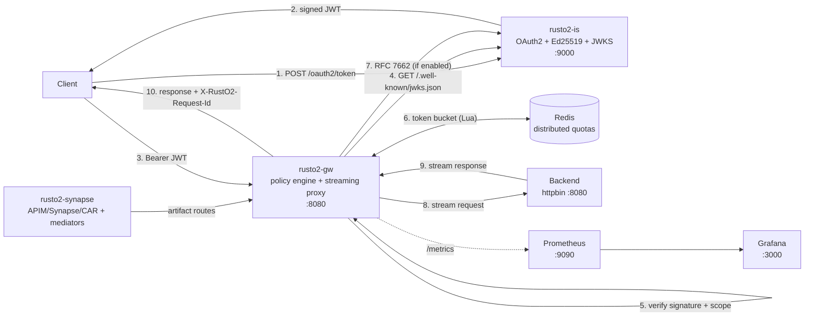
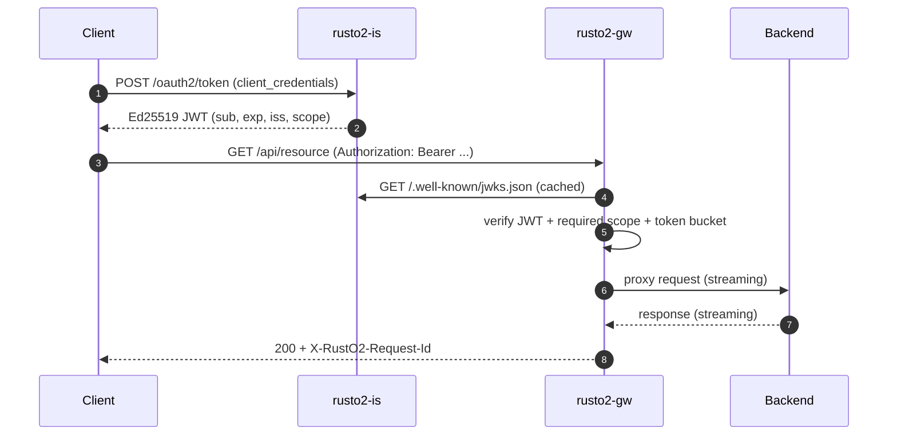

<p align="center">
  
</p>

<h1 align="center">RustO2</h1>

<p align="center">
  <strong>A high-performance Rust re-implementation of the WSO2 gateway core.</strong><br/>
  OAuth2 · Ed25519 JWT · JWKS · rate limiting · circuit breaking · Prometheus · Grafana
</p>

<p align="center">
  <a href="https://github.com/togioia/RustO2/actions/workflows/ci.yml"></a>
  <a href="LICENSE"></a>
  
  
</p>

<p align="center"><a href="README.it.md">Italiano</a></p>

---

## Why RustO2?

WSO2's integration stack is built around a powerful set of ideas: a mediation
pipeline, per-API security policies, throttling, endpoint resilience and
observability. RustO2 rebuilds the *core* of that model in Rust as a focused,
cloud-native experiment:

- **No application server, no OSGi, no management console.** Two static binaries,
  YAML configuration and a container.
- **No garbage collector.** Request handling is ownership-based, so there are no
  GC pauses to pollute tail latency.
- **Streaming by default for native routes.** Request and response bodies are
  piped through the gateway without being buffered; WSO2 artifact routes buffer
  only as much as mediation needs, within `artifacts.max_body_bytes`.
- **Security without shared secrets.** `rusto2-is` signs Ed25519 JWTs and
  publishes the public key as JWKS; `rusto2-gw` verifies tokens locally.

This is **not** a WSO2 fork and contains no WSO2 code. It is an independent
implementation whose target is **behavioral parity with the WSO2 API Manager
Gateway/Key Manager core**, plus a practical subset of Micro Integrator
mediation. It now imports APIM `api.yaml` definitions, Synapse `<api>`/sequence
XML and CAR packages, and executes a growing mediator subset. The honest gap
analysis and milestone plan live in
[docs/WSO2_PARITY.md](docs/WSO2_PARITY.md); the supported Synapse subset is
documented in [docs/SYNAPSE.md](docs/SYNAPSE.md).

## What is implemented

| WSO2 concept | RustO2 implementation |
|---|---|
| WSO2 artifacts | APIM `api.yaml`, Synapse `<api>`/`<sequence>` XML and `.car` ZIP import |
| Synapse mediation subset | `rusto2-synapse`: `log`, `property`, `filter`, `switch`, `payloadFactory`, `enrich`, `call`, `send`, `respond`, `header`, `drop`, named sequences/endpoints and fault sequences |
| API Gateway / reverse proxy | `rusto2-gw`: axum server, streaming reqwest proxy for native routes |
| Per-API security policy | Declarative routes in `rusto2.yaml` with method allowlists, JWT and scopes |
| Key manager / OAuth2 token service | `rusto2-is`: `client_credentials`, Ed25519 JWTs, JWKS, discovery, RFC 7662/7009 |
| JWT validation at the gateway | Axum middleware with in-memory JWKS cache and key rotation refresh |
| Throttling | Pluggable DashMap or Redis token bucket per `client_id` or client IP |
| Token lifecycle | `jti` blocklist with TTL, opt-in introspection and a short gateway cache |
| Endpoint circuit breaker | Per-route closed / open / half-open state machine |
| Observability | JSON logs, request correlation, Prometheus metrics, Grafana dashboard |
| Deployment | Multi-stage distroless images, Docker Compose demo, Helm chart with probes/HPA/PDB |

### Feature checklist

- [x] APIM API definition import: context/version, operations, scopes, endpoint
- [x] Synapse `<api>` import with URI templates and in/out/fault sequences
- [x] CAR package loading with size limits and explicit unsupported-artifact warnings
- [x] Mediation engine: `log`, `property`, `filter`, `switch`, `payloadFactory`,
      `enrich`, `call`, `send`, `respond`, `header`, `drop`, named sequences/endpoints
- [x] Explicit failure on unsupported mediators, endpoints and security schemes
- [x] Per-route allowlisted methods, upstream and strip-prefix policies
- [x] Streaming request/response proxying with connection pooling
- [x] `X-Forwarded-For`, `X-Forwarded-Host`, `X-Forwarded-Proto`
- [x] `X-RustO2-Request-Id` + `X-Request-Id` correlation end to end
- [x] OAuth2 `POST /oauth2/token` (form or JSON, Basic or body credentials)
- [x] Ed25519 key generation or PEM loading, `kid` thumbprint, JWKS ETag
- [x] JWT signature, `iss`, `aud`, `exp`, `nbf` and scope validation
- [x] Token-bucket rate limiting with `429`, `X-RateLimit-*`, `Retry-After`
- [x] Pluggable quota backend: in-process DashMap or distributed Redis Lua
- [x] RFC 7662 introspection, RFC 7009 revocation and gateway-side revocation cache
- [x] Circuit breaker with `503` fail-fast and half-open recovery
- [x] Prometheus counters, histograms and in-flight gauge on `/metrics`
- [x] Structured JSON logs with request id, route, status and latency
- [x] Docker Compose stack with httpbin, Redis, Prometheus and Grafana
- [x] Helm chart with probes, HPA, PDB, NetworkPolicy and ServiceMonitor
- [x] cargo-audit/cargo-deny, SBOM, cosign signing and SLSA provenance
- [x] Unit tests, property tests, cargo-fuzz, end-to-end smoke script and CI

## Architecture





### WSO2 artifact compatibility

Artifacts are loaded at startup from `artifacts.paths`. Each resource becomes a
route with the WSO2 path shape `/context/version/resource`, and is executed by
the Synapse mediation engine. Native `rusto2.yaml` routes keep the streaming
proxy path.

| Artifact | What is imported |
|---|---|
| APIM `api.yaml` | name, context, version, lifecycle state, endpoint, operations, HTTP verbs and OAuth2 scopes |
| OpenAPI with `x-wso2-*` | base path, server/endpoint URLs, operations and scopes |
| Synapse `<api>` | resources, URI templates, in/out/fault sequences and named sequence/endpoint references |
| Synapse `<sequence>` / `<endpoint>` | named definitions used by API sequences |
| `.car` | ZIP scan for the artifact types above; proxy services, tasks and stores are reported as unsupported |

The demo loads one APIM definition and one Synapse API:

```bash
TOKEN=$(curl -s -X POST http://localhost:9000/oauth2/token \
  -H 'Content-Type: application/x-www-form-urlencoded' \
  --data-urlencode grant_type=client_credentials \
  --data-urlencode client_id=demo-client \
  --data-urlencode client_secret=demo-secret \
  --data-urlencode 'scope=read write' \
  | sed -n 's/.*"access_token":"\([^"]*\)".*/\1/p')

# APIM api.yaml: GET /pizzashack/1.0.0/get
curl -i -H "Authorization: Bearer $TOKEN" \
  http://localhost:8080/pizzashack/1.0.0/get

# Synapse <api>: property -> filter -> switch -> payloadFactory -> outSequence
curl -i -H "Authorization: Bearer $TOKEN" \
  http://localhost:8080/demo/1.0.0/items/42

# Synapse call through a named endpoint + outSequence
curl -i -H "Authorization: Bearer $TOKEN" \
  http://localhost:8080/demo/1.0.0/anything/foo
```

`examples/wso2/build-car.sh` packages the same artifacts as a `.car`; point
`artifacts.paths` at the archive to exercise the CAR loader.

Unsupported mediators fail **at startup** with the mediator name and XML
location. Unsupported artifact types inside a CAR are logged and skipped; the
loaded APIs still start, which matches a partial deployment better than a silent
drop. See [docs/SYNAPSE.md](docs/SYNAPSE.md) for the exact mediator and
expression subset.

### Security model

1. On startup the gateway fetches the JWKS from `rusto2-is` (and keeps retrying if
   the identity server is still booting).
2. Every protected request is checked against a `kid`-selected Ed25519 key.
   Signature, issuer, audience, expiry and not-before are validated.
3. The route's required scopes must be a subset of the token's `scope` claim.
4. An unknown `kid` triggers a rate-limited JWKS refresh, so key rotation works
   without a gateway restart.
5. Failed refreshes keep the last known-good keys: a short identity-server
   outage does not take the data plane down.

### Traffic and resilience

- **Token bucket.** Each `(route, client_id)` or `(route, IP)` key has a bucket
  with `rps` refill and `burst` capacity. The default in-memory backend shards
  state with DashMap; the Redis backend runs the refill atomically in Lua so all
  gateway replicas share the same quota. If Redis is down, `fail_open` decides
  between availability and strict quota (`503`).
- **429 responses** include `X-RateLimit-Limit`, `X-RateLimit-Remaining` and
  `Retry-After`; the request never reaches the backend. `X-RateLimit-Limit` is
  the bucket capacity (`burst`), while `rps` is the sustained refill rate.
- **Revocation.** Protected routes can opt into `revocation_check`. The gateway
  caches RFC 7662 introspection results for a few seconds, so a revoked `jti`
  stops working without paying an identity round trip on every request. Routes
  without the flag keep the pure local-JWKS fast path.
- **Circuit breaker.** Five consecutive upstream errors (configurable) open the
  route circuit. Requests fail fast with `503` and `Retry-After`. After the
  recovery window, a single half-open probe decides whether to close or reopen.

## Quick start

Requirements: Docker with Compose v2. Nothing else.

```bash
git clone https://github.com/togioia/RustO2.git
cd RustO2
docker compose up -d --build
./scripts/demo.sh
```

Then open:

| Service | URL | Credentials |
|---|---|---|
| Gateway | http://localhost:8080 | JWT from `rusto2-is` |
| Identity server | http://localhost:9000 | demo client below |
| Prometheus | http://localhost:9090 | — |
| Grafana | http://localhost:3000 | `admin` / `admin` |
| httpbin (direct) | http://localhost:8081 | — |
| Redis | internal only (`redis:6379`) | — |

Demo clients (override with environment variables):

| client_id | client_secret | scopes |
|---|---|---|
| `demo-client` | `demo-secret` | `read`, `write`, `admin` |
| `readonly-client` | `readonly-secret` | `read` |
| `gateway-client` | `gateway-secret` | `introspect` (used by the gateway) |

> The demo secrets are intentionally public. Replace them via
> `RUSTO2_DEMO_SECRET` / `RUSTO2_READONLY_SECRET` / `RUSTO2_GATEWAY_SECRET`
> before exposing anything.

## curl cookbook

### 1. Get an access token

```bash
TOKEN=$(curl -s -X POST http://localhost:9000/oauth2/token \
  -H "Content-Type: application/x-www-form-urlencoded" \
  -d "grant_type=client_credentials" \
  -d "client_id=demo-client" \
  -d "client_secret=demo-secret" \
  -d "scope=read write" | sed -n 's/.*"access_token":"\([^"]*\)".*/\1/p')

echo "${TOKEN:0:40}..."
```

HTTP Basic is supported too:

```bash
curl -u demo-client:demo-secret \
  -d "grant_type=client_credentials&scope=read" \
  http://localhost:9000/oauth2/token
```

### 2. Call a protected API

```bash
curl -i -H "Authorization: Bearer $TOKEN" \
  "http://localhost:8080/api/get?hello=rusto2"
```

The gateway forwards the request to httpbin with the original body streamed and
adds the correlation and forwarding headers:

```http
HTTP/1.1 200 OK
x-rusto2-request-id: 0192f0a1-7c3e-7b1a-9a2e-5f2b1c3d4e5f
```

### 3. Exercise security policies

```bash
# 401: no token
curl -i http://localhost:8080/api/get

# 403: read-only client on a write-scoped route
READONLY_TOKEN=$(curl -s -X POST http://localhost:9000/oauth2/token \
  -d "grant_type=client_credentials" \
  -d "client_id=readonly-client" \
  -d "client_secret=readonly-secret" \
  | sed -n 's/.*"access_token":"\([^"]*\)".*/\1/p')
curl -i -H "Authorization: Bearer $READONLY_TOKEN" \
  http://localhost:8080/admin/get

# 405: POST is not allowed on /public
curl -i -X POST http://localhost:8080/public/get

# 200: anonymous route
curl -i http://localhost:8080/public/get
```

### 4. See the rate limiter

```bash
for i in $(seq 1 15); do
  curl -s -o /dev/null -w "%{http_code}\n" http://localhost:8080/public/get
done
```

With `rps: 10` and `burst: 10`, the first requests succeed and the rest return:

```http
HTTP/1.1 429 Too Many Requests
x-ratelimit-limit: 10
x-ratelimit-remaining: 0
retry-after: 1
```

### 5. Inspect JWKS and metrics

```bash
curl -s http://localhost:9000/.well-known/jwks.json | python -m json.tool
curl -s http://localhost:9000/.well-known/openid-configuration | python -m json.tool
curl -s http://localhost:8080/metrics | grep '^rusto2_'
```

Decoded JWT payload:

```json
{
  "sub": "demo-client",
  "iss": "http://localhost:9000",
  "aud": "rusto2",
  "exp": 1790000000,
  "iat": 1789996400,
  "nbf": 1789996400,
  "jti": "0192f0a1-7c3e-7b1a-9a2e-5f2b1c3d4e5f",
  "scope": "read write",
  "client_id": "demo-client"
}
```

### 6. Introspect and revoke a token

```bash
# Introspection (RFC 7662) uses the gateway-client credentials.
curl -s -u gateway-client:gateway-secret \
  -d "token=$TOKEN" \
  http://localhost:9000/oauth2/introspect

# Revoke the token as its owner (RFC 7009).
curl -s -o /dev/null -w "%{http_code}\n" \
  -u demo-client:demo-secret \
  -d "token=$TOKEN" \
  http://localhost:9000/oauth2/revoke

# The introspection endpoint now returns active=false.
curl -s -u gateway-client:gateway-secret \
  -d "token=$TOKEN" \
  http://localhost:9000/oauth2/introspect
```

`/admin` has `revocation_check: true`, so after the gateway's 5-second cache
window a revoked token gets `401`. `/api` keeps the fast local-JWKS path and does
not call introspection, which is the trade-off exposed by the per-route flag.

## Configuration

### `rusto2.yaml` — gateway

```yaml
server:
  listen: 0.0.0.0:8080
  trust_proxy: false          # honour X-Forwarded-For for the client IP
  request_timeout_secs: 30
  connect_timeout_secs: 5
  pool_max_idle_per_host: 256

identity:
  issuer: http://localhost:9000
  audience: rusto2
  jwks_url: http://localhost:9000/.well-known/jwks.json
  refresh_secs: 300
  leeway_secs: 15
  introspection_url: http://localhost:9000/oauth2/introspect
  introspection_client_id: gateway-client
  introspection_client_secret: ${RUSTO2_GATEWAY_SECRET:-gateway-secret}
  revocation_cache_secs: 5
  revocation_fail_open: true

rate_limiting:
  backend: memory             # memory | redis
  redis_url: redis://127.0.0.1:6379/0
  key_prefix: "rusto2:ratelimit:"
  fail_open: true

artifacts:
  paths:
    - ./examples/wso2/apim
    - ./examples/wso2/synapse
  auth: jwt                   # security for plain Synapse <api> resources
  scopes: []
  revocation_check: false
  max_body_bytes: 2097152     # mediated routes buffer up to this limit
  default_upstream: http://httpbin:8080

routes:
  - name: httpbin
    prefix: /api
    upstream: http://httpbin:8080
    strip_prefix: true
    methods: [GET, POST, PUT, PATCH, DELETE, HEAD, OPTIONS]
    auth:
      mode: jwt                 # jwt | none
      scopes: [read]
    rate_limit:
      rps: 100
      burst: 200
      key: client               # client | ip
    circuit_breaker:
      failure_threshold: 5
      recovery_secs: 10

  - name: admin
    prefix: /admin
    upstream: http://httpbin:8080
    strip_prefix: true
    methods: [GET]
    auth:
      mode: jwt
      scopes: [write]
      revocation_check: true
    rate_limit:
      rps: 30
      burst: 60
      key: client
```

Routes are matched by longest prefix on segment boundaries, so `/api/v2` can
override `/api`. The method allowlist is enforced **before** authentication and
returns `405` with an `Allow` header.

### `rusto2-is.yaml` — identity server

```yaml
token:
  issuer: http://localhost:9000
  audience: rusto2
  ttl_secs: 3600

keys:
  private_key_path: ./data/ed25519.pem
  generate_if_missing: true

revocation:
  max_ttl_secs: 86400

clients:
  - client_id: demo-client
    client_secret: ${RUSTO2_DEMO_SECRET:-demo-secret}
    scopes: [read, write, admin]
  - client_id: gateway-client
    client_secret: ${RUSTO2_GATEWAY_SECRET:-gateway-secret}
    scopes: [introspect]
```

If the PEM file is absent and `generate_if_missing` is true, a new Ed25519
PKCS#8 key is generated with mode `0600`. `${VAR}` and `${VAR:-default}` are
expanded from the environment.

### Environment overrides

| Variable | Service | Purpose |
|---|---|---|
| `RUSTO2_CONFIG` | both | Path to the YAML file |
| `RUSTO2_ARTIFACTS_DIR` | gateway | Base directory for WSO2 artifacts in containers |
| `RUSTO2_GW_LISTEN` | gateway | Override listen address |
| `RUSTO2_ISSUER` | gateway | Expected JWT issuer |
| `RUSTO2_JWKS_URL` | gateway | Internal JWKS URL |
| `RUSTO2_RATE_LIMIT_RPS` | gateway | Override every route's `rps`; `0` disables limiting |
| `RUSTO2_RATE_LIMIT_BURST` | gateway | Override every route's burst |
| `RUSTO2_RATE_LIMIT_BACKEND` | gateway | `memory` or `redis` |
| `RUSTO2_REDIS_URL` | gateway | Redis URL for distributed quotas |
| `RUSTO2_RATE_LIMIT_PREFIX` | gateway | Redis key namespace |
| `RUSTO2_RATE_LIMIT_FAIL_OPEN` | gateway | Allow traffic when Redis is unavailable |
| `RUSTO2_INTROSPECTION_URL` | gateway | RFC 7662 endpoint |
| `RUSTO2_GATEWAY_CLIENT_ID` | gateway | Client id used for introspection |
| `RUSTO2_GATEWAY_SECRET` | both | Gateway introspection client secret |
| `RUSTO2_REVOCATION_CACHE_SECS` | gateway | Introspection result cache TTL |
| `RUSTO2_REVOCATION_FAIL_OPEN` | gateway | Allow traffic when introspection fails |
| `RUSTO2_IS_LISTEN` | identity | Override listen address |
| `RUSTO2_ISSUER` | identity | Override the issuer placed in tokens |
| `RUSTO2_AUDIENCE` | identity | Override the JWT audience |
| `RUSTO2_KEY_PATH` | identity | Override private key path |
| `RUST_LOG` | both | `tracing` filter, e.g. `info,rusto2_gw=debug` |

## Observability

Logs are single-line JSON on stdout, including the correlation id:

```json
{"timestamp":"2026-11-11T10:00:00.000Z","level":"INFO","message":"request completed","status":200,"latency_ms":0.84,"target":"rusto2_common::telemetry","span":{"method":"GET","path":"/api/get","request_id":"01a1caa8-570b-767a-99b2-ec74f316b80b","name":"http.request"}}
```

Metrics exposed by the gateway:

| Metric | Type | Labels |
|---|---|---|
| `rusto2_http_requests_total` | counter | `route`, `method`, `status` |
| `rusto2_http_request_duration_seconds` | histogram | `route` |
| `rusto2_auth_failures_total` | counter | `reason`, `route` |
| `rusto2_rate_limited_total` | counter | `route` |
| `rusto2_rate_limit_errors_total` | counter | `route`, `backend` |
| `rusto2_circuit_open_total` | counter | `route` |
| `rusto2_circuit_rejected_total` | counter | `route` |
| `rusto2_revocation_errors_total` | counter | `route` |
| `rusto2_upstream_errors_total` | counter | `route` |
| `rusto2_gateway_inflight` | gauge | — |
| `rusto2_identity_tokens_issued_total` | counter | `client` |
| `rusto2_identity_token_errors_total` | counter | `reason` |
| `rusto2_identity_introspections_total` | counter | `result` |
| `rusto2_identity_revocations_total` | counter | — |

The Grafana dashboard is provisioned automatically from
`deploy/grafana/dashboards/rusto2.json`. Prometheus alert rules for auth failure
spikes, quota-backend errors, open circuits, upstream errors and introspection
failures live in `deploy/prometheus/alerts.yml`.

## Performance

### Benchmark setup

Measured on 11 November 2026 on a WSL2 Ubuntu 22.04 host with 8 vCPUs and 16 GB
of RAM. The gateway and identity server were the exact static musl binaries that
ship in the distroless images, executed without container overhead so Docker
network plumbing would not hide the proxy cost. The backend was
`go-httpbin 2.26.0`; the load generator was `oha 1.16.0` with 128 keep-alive
connections for 15 seconds after a 3-second warm-up.

Every request carried a pre-issued Ed25519 JWT; signature, issuer, audience,
expiry and scope were validated on the gateway, with the JWKS cached in memory.
Rate limiting was disabled for the throughput rows so the proxy path is measured,
then enabled for the throttling row. The default Compose stack uses Redis for
distributed quotas; the benchmark overlay pins the in-memory backend so the table
isolates the proxy rather than Redis network overhead.

| Scenario | Throughput | p50 | p99 | RSS under load |
|---|---:|---:|---:|---:|
| Direct httpbin (no gateway) | 30,965 req/s | 1.24 ms | 31.17 ms | 19.3 MiB |
| RustO2, 64 connections, JWT | 12,086 req/s | 4.59 ms | 15.39 ms | 18.0 MiB |
| RustO2, 128 connections, JWT | **12,885 req/s** | 8.62 ms | 29.08 ms | **18.0 MiB** |
| RustO2, GitHub Actions + Docker, 128 connections | 8,095 req/s | 15.14 ms | 32.97 ms | 12.0 MiB |
| RustO2, rate limit 100 rps/client | 1,160 allowed / 264,885 rejected (`429`) in 8 s | 1.63 ms | 6.26 ms | — |

The last row is the point of the throttle: while the limiter admitted about
1,160 requests, it rejected 264,885 with an immediate `429` (33k rejections/s)
and the backend never saw them. The p99 of that run is dominated by the fast
`429` responses, not by backend latency.

### Memory and image size

| Process | Idle RSS | RSS after 15 s at 12.9k req/s |
|---|---:|---:|
| `rusto2-gw` | 5.3 MiB | 17.9 MiB |
| `rusto2-is` | 4.1 MiB | 4.2 MiB |

Container images, both based on distroless static Debian and statically linked
against musl:

| Image | Size |
|---|---:|
| `rusto2-gw:dev` | **8.75 MB** |
| `rusto2-is:dev` | **6.32 MB** |

RustO2 uses the mimalloc global allocator with immediate purging
(`MIMALLOC_PURGE_DELAY=0`) to avoid retaining freed arenas. There is no JVM heap,
no GC and no warm-up phase: the process goes from zero to steady state without a
stop-the-world pause.

These are orders of magnitude, not a vendor benchmark: the load generator and
the services shared the same 8 vCPUs, and WSL2 scheduling noise is visible in the
baseline p99. Repeated 15-second runs of the same build ranged from roughly
8.9k to 12.9k req/s, so treat the absolute RPS as indicative rather than a
laboratory measurement. The interesting result is that the gateway adds a
constant, small memory cost and no GC pauses, so latency stays bounded under
concurrency. The 64-connection run shows the latency profile without queueing:
p50 4.6 ms, p99 15.4 ms.

Reproduce:

```bash
docker compose -f docker-compose.yml -f docker-compose.bench.yml up -d --build
bash scripts/bench.sh
```

Raw summaries and environment details: [docs/BENCHMARKS.md](docs/BENCHMARKS.md).
The `Benchmark` GitHub Actions workflow runs the same containerized benchmark on
every release tag and uploads the raw report as an artifact.

The benchmark overlay disables rate limiting so the proxy + JWT path can be
measured at full speed. Running through Docker's port forwarding in the
v0.2.0 GitHub Actions benchmark measured 8,095 req/s (p99 32.97 ms) versus
12,885 req/s for the same static binaries directly; the table reports both so
it is clear what is RustO2 and what is container networking. To measure the
limiter, run against the default stack; `/public` is capped at 10 rps per IP.

## Kubernetes

A production-minded Helm chart lives in `deploy/helm/rusto2`: ConfigMaps for the
routes and clients, Secret/PVC handling for the signing key, liveness and
readiness probes, gateway HPA, PodDisruptionBudgets, NetworkPolicies and an
optional ServiceMonitor. The chart does not deploy a backend or Redis; point its
values at your own services.

```bash
helm upgrade --install rusto2 deploy/helm/rusto2 \
  --namespace rusto2 --create-namespace
kubectl -n rusto2 port-forward svc/rusto2-gw 8080:8080
```

See [docs/KUBERNETES.md](docs/KUBERNETES.md) for image loading, HPA, key
sharing, Redis quotas and revocation settings.

## Supply chain

On a `v*` tag, the release workflow builds the two images, publishes them to
GHCR, generates SPDX SBOMs with Syft, signs the image digests keyless with
cosign and attaches SLSA build provenance. CI also runs `cargo-audit`
(non-blocking advisory scan) and `cargo-deny` (blocking policy gate).

```bash
cosign verify ghcr.io/togioia/rusto2-gw:0.3.0 \
  --certificate-identity-regexp 'https://github.com/togioia/RustO2/.github/workflows/release.yml@.*' \
  --certificate-oidc-issuer https://token.actions.githubusercontent.com

gh attestation verify oci://ghcr.io/togioia/rusto2-gw:0.3.0 \
  --repo togioia/RustO2
```

See [docs/SUPPLY_CHAIN.md](docs/SUPPLY_CHAIN.md) for the full policy, SBOM
artifacts and verification commands.

## Testing

```bash
cargo test --workspace --all-targets   # unit tests
cargo clippy --workspace --all-targets -- -D warnings
./scripts/smoke.sh                     # end-to-end against the running stack
```

The smoke script covers token issuance, JWKS, valid/invalid/missing JWT, scope
enforcement, method allowlists, anonymous routes, `429` rate limiting,
RFC 7662/7009 introspection/revocation, circuit breaker opening and recovery,
and Prometheus output.

Property-based tests live in the crate test modules; the JWT header and env
expander fuzz targets are documented in [docs/FUZZING.md](docs/FUZZING.md).

## Repository layout

```text
crates/
  rusto2-common/   telemetry, request correlation, env expansion
  rusto2-is/       OAuth2 client_credentials, Ed25519 keys, JWKS, revocation
  rusto2-synapse/  WSO2 artifact parser, MessageContext and mediation engine
  rusto2-gw/       proxy, route policy, JWT filter, quota backends, breaker
deploy/
  prometheus/      scrape configuration and alert rules
  grafana/         datasource, dashboard provisioning, dashboard JSON
  helm/rusto2/     production-minded Kubernetes chart
docs/              WSO2 parity matrix, Synapse subset, Kubernetes, supply chain, fuzzing, benchmarks
examples/wso2/     APIM api.yaml, Synapse <api>/sequences and CAR build script
docker/            multi-stage distroless Dockerfiles
fuzz/              cargo-fuzz targets (excluded from the normal workspace)
scripts/           demo, smoke, benchmark and oha installer
rusto2.yaml        gateway routes and policies
rusto2-is.yaml     clients, issuer, key location
```

## Design notes and limitations

- **Streaming for native routes, buffering for mediated routes.** YAML routes use
  `reqwest::Body::wrap_stream` and `Body::from_stream`, so large payloads stay
  flat. WSO2 artifact routes must materialize the body to run `payloadFactory`,
  `enrich` and expressions; `artifacts.max_body_bytes` bounds that buffer
  (2 MiB by default) and returns `413` beyond it. The gateway does not retry
  non-idempotent requests.
- **Mediation is a deliberate subset.** `rusto2-synapse` implements the
  mediators listed in [docs/SYNAPSE.md](docs/SYNAPSE.md). `class`, `script`,
  `xslt`, `iterate`, `clone`, `aggregate` and the rest fail at startup rather
  than being skipped. Java class mediators are out of scope; a native plugin ABI
  is the intended extension point.
- **APIM policy is partial.** OAuth2 scopes and PUBLISHED/DEPRECATED lifecycle
  state are enforced. API keys, subscriptions, Bronze/Silver/Gold tiers, custom
  throttling policies, backend JWT, CORS and failover/load-balanced endpoints
  are M3 work. APIs using an unsupported security scheme, endpoint type or
  custom authorization header are rejected at load time.
- **Latency accounting.** The gateway's Prometheus histogram stops when the
  upstream response headers arrive; oha measures the full request/response cycle.
  Both are useful, but they are not the same number.
- **Ed25519 only.** The JWKS filter deliberately rejects non-EdDSA keys to avoid
  algorithm-confusion attacks. RSA support would be a small extension.
- **Single identity-server key.** Key rotation is supported through the JWKS
  refresh path, but `rusto2-is` publishes one active key at a time.
- **In-memory quotas.** The default rate-limit backend and circuit state are per
  gateway instance. The Redis backend solves quotas for multi-replica
  deployments; circuit state is still local. Revocation entries live in the
  identity server's memory, so a multi-replica `rusto2-is` needs a shared store.
- **Revocation is opt-in and eventually consistent.** `/admin` checks a
  short-lived introspection cache; `/api` keeps the zero-network local-JWKS
  fast path. Revocations live in the identity server's memory and are lost on
  restart or when scaling to multiple identity replicas.
- **Not production hardened.** There is no TLS listener, admin API, refresh token
  flow, OAuth2 authorization code/PKCE or persistent audit log. See
  [SECURITY.md](SECURITY.md).

## Roadmap

The primary roadmap is the WSO2 fidelity track in
[docs/WSO2_PARITY.md](docs/WSO2_PARITY.md):

1. **M1 — WSO2 artifacts: implemented.** APIM `api.yaml`, OpenAPI with
   `x-wso2-*`, Synapse `<api>`/`<sequence>`/`<endpoint>` XML and `.car` import.
2. **M2 — Mediation engine: implemented for the documented subset.** `log`,
   `property`, `filter`, `switch`, `payloadFactory`, `enrich`, `call`, `send`,
   `respond`, `header`, `drop`, named sequences/endpoints and fault sequences.
   Next: more expressions, XML enrichment and a native plugin ABI.
3. **M3 — APIM semantics (next):** applications/subscriptions, tiers, API
   keys, backend JWT, CORS, failover/load-balanced endpoints and fuller
   lifecycle enforcement.
4. **M4 — Key manager:** authorization code/PKCE, password grant, refresh tokens,
   DCR, opaque tokens and multiple key managers.
5. **M5 — Traffic Manager parity:** APIM tier policies and advanced throttling.
6. **M6 — MI subset:** data services, tasks, stores/processors, hot deployment
   and OTel/analytics.

Supporting platform work, lower priority until M1–M3 are credible:

- OpenTelemetry OTLP traces exported to Tempo/Jaeger
- Hot reload of configuration and CAR artifacts
- Shared revocation storage for a multi-replica identity server
- TLS/mTLS, overlapping JWT key rotation and Argon2 client secrets
- Fuzzing and property tests wired into scheduled CI
- SHA-pinned GitHub Actions and OpenSSF Scorecard

## License

Apache-2.0. RustO2 is an independent project and is not affiliated with WSO2
LLC; see [NOTICE](NOTICE).

## Contributing

Contributions are welcome. Read [CONTRIBUTING.md](CONTRIBUTING.md) for the
development workflow and the [Code of Conduct](CODE_OF_CONDUCT.md) before
participating. Security issues must be reported privately, as described in
[SECURITY.md](SECURITY.md).

<p align="center"><sub>A focused, cloud-native take on the core of a WSO2-style API gateway.</sub></p>
